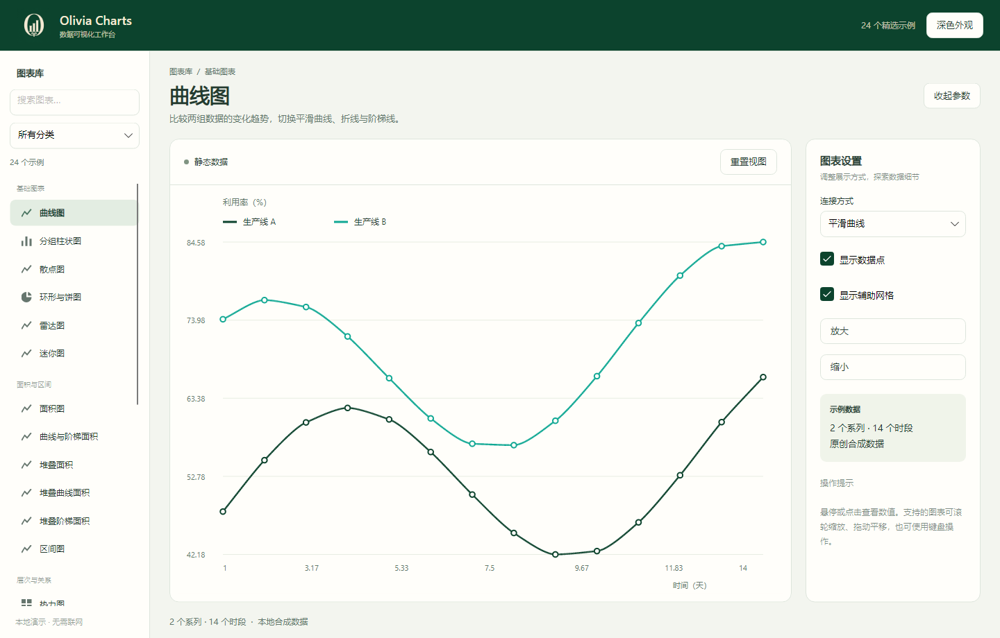
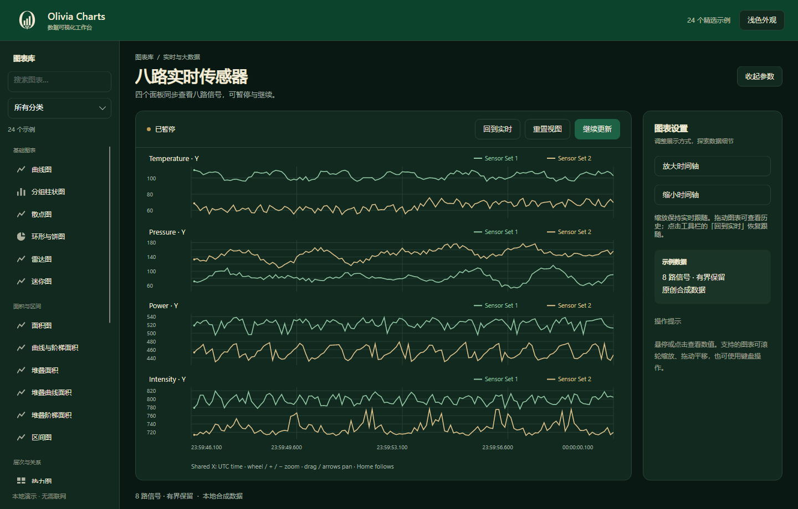
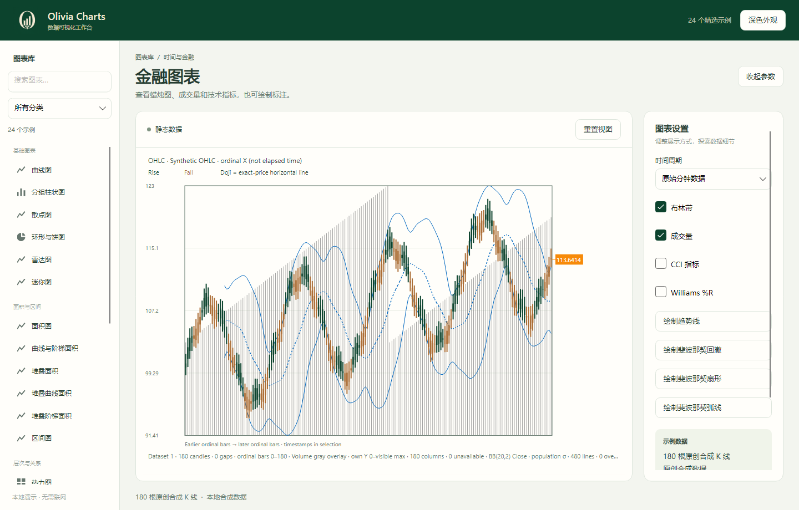

<p align="center">
  
</p>

<h1 align="center">Olivia Charts</h1>

<p align="center">面向 .NET 与 Avalonia 的交互式图表库。</p>

<p align="center">
  <a href="README.md">English</a> · <strong>简体中文</strong><br>
  <a href="#图表一览">图表一览</a> · <a href="#运行-demo">运行 Demo</a> · <a href="docs/DEVELOPMENT.md">开发指南</a>
</p>

Olivia Charts 将常用图表、时间序列、金融分析和实时信号展示整合到桌面图表工作台中。通过 **5 个分类、24 个示例**体验交互效果，切换明暗主题，并在参数面板中调整当前图表的显示方式。

**开发预览版** · `0.1.0-alpha.3` · .NET 8 · Avalonia



## 主要功能

- **交互探索数据**：柱状图和散点图支持围绕鼠标缩放、拖动查看其他区域；时间序列可通过概览导航，或用双轴比较不同量纲的数据。
- **跟踪实时信号**：四个面板展示八路传感器数据。支持暂停更新、持续采集时回看历史，以及恢复实时跟随。
- **分析金融序列**：提供 K 线、时间周期、成交量、布林带、CCI、Williams %R，以及趋势线和斐波那契绘图工具。
- **查看大规模数据**：两条各含 100 万采样点的曲线，按当前可见范围准备显示数据，支持缩放观察局部。
- **调整图表外观**：切换明暗主题、收起参数面板，并按图表类型调整连接方式、数据点、辅助网格和系列显示。

## 图表一览

| 分类 | 示例 |
| --- | --- |
| **基础图表 · 6** | 曲线图、分组柱状图、散点图、环形与饼图、雷达图、迷你图 |
| **面积与区间 · 6** | 面积图、曲线与阶梯面积、堆叠面积、堆叠曲线面积、堆叠阶梯面积、区间图 |
| **层次与关系 · 4** | 热力图、矩形树图、旭日图、流向图 |
| **时间与金融 · 5** | 历史曲线、时间范围导航、双轴曲线、多系列曲线、金融图表 |
| **实时与大数据 · 3** | 八路实时传感器、实时散点、百万点曲线 |

| 实时传感器 · 深色主题 | 金融图表 · 浅色主题 |
| :---: | :---: |
| [](docs/images/demo-sensors-dark.png) | [](docs/images/demo-financial-light.png) |

以上均为 Demo 实际截图。示例数据在本地生成，运行时无需连接数据服务。

## 运行 Demo

安装 **.NET 10 SDK** 和 **.NET 8 Runtime**，然后执行：

```sh
git clone https://github.com/Reizk/Olivia.Charts.git
cd Olivia.Charts
dotnet restore Olivia.Charts.sln --locked-mode
dotnet build Olivia.Charts.sln -c Release --no-restore
dotnet run --project samples/Olivia.Charts.Demo -c Release --no-build
```

从左侧选择示例，在右侧参数面板调整选项，即可体验不同图表。缩放、暂停、重置和实时跟随等操作见 [Demo 使用简介](docs/DEMO-OVERVIEW.zh-en.md)。

当前预览版通过源码构建，尚未提供公开 NuGet 包。

## 文档

- [Demo 功能与操作](docs/DEMO-OVERVIEW.zh-en.md)：中英文使用简介。
- [开发指南](docs/DEVELOPMENT.md)：项目结构、测试与本地打包。
- [详细功能覆盖](docs/COVERAGE.zh-CN.md)：图表与示例的覆盖范围。

## 许可证

当前预览版尚未指定开源许可证。
